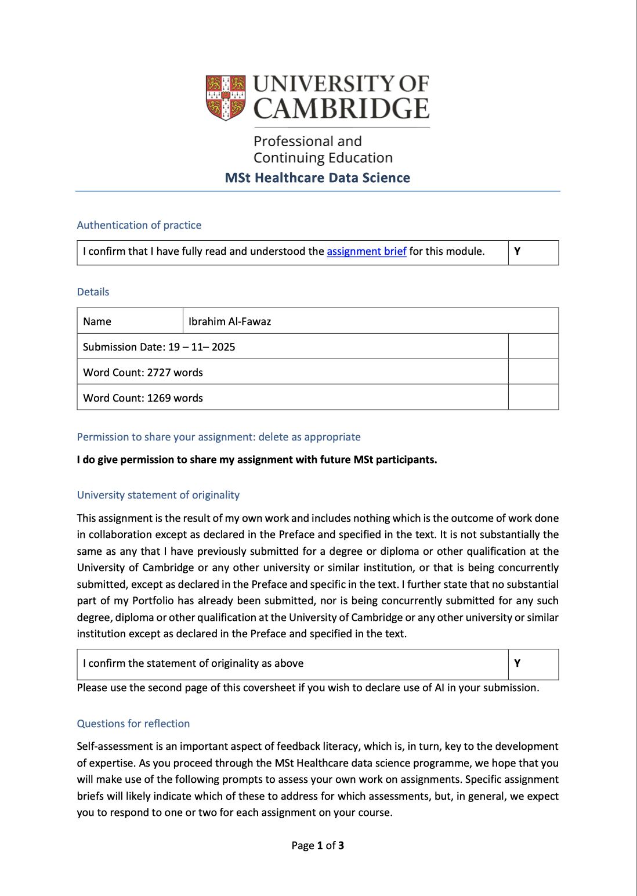

---
title: "The Impact Of Having Co-morbidities On The Prevalence Rate Of Covid-19 Among Multiple Sclerosis Patients"
author: "IBB"
date: "2025-10-16"
output: 
  prettydoc::html_pretty:
    theme: cayman
    toc: yes
bibliography: [references.bib,MS.bib, covid_MS.bib]
csl: vancouver.csl   
---

```{r setup, include=FALSE, echo=FALSE}
knitr::opts_chunk$set(echo = TRUE)

if(!require(tidyverse)) install.packages("tidyverse", repos = "http://cran.us.r-project.org")
if(!require(knitr)) install.packages("knitr", repos = "http://cran.us.r-project.org")
if(!require(DT)) install.packages("DT", repos = "http://cran.us.r-project.org")
if(!require(gtsummary)) install.packages("gtsummary", repos = "http://cran.us.r-project.org")
if(!require(broom)) install.packages("broom", repos = "http://cran.us.r-project.org")

# Load the packages

library(tidyverse)
library(knitr)
library(DT)
library(gtsummary)
library(broom)
library(epitools)

```

```{R, message=FALSE, echo=FALSE}

# Import the dataset
#The following script needs to be replaced with appropriate file directly

# Covid_MS <- read_excel("Downloads/GDSI_OpenDataset_Final.xls")
library(readxl)

Covid_MS <-  read.csv(
  "https://raw.githubusercontent.com/CambridgeICE-HDS/MSt-Healthcare-Data-Science/main/Datasets/COVID-MS/GDSI_OpenDataset_Final.csv",
  stringsAsFactors = FALSE
)

```

# Abstract 

**Background:** Multiple sclerosis (MS) is an autoimmune disease of the central nervous system and a leading cause of disability in young adults. Patients with MS often receive immunomodulatory therapies that can increase their risk of infections and related complications. The emergence of COVID-19, caused by SARS-CoV-2, has raised concerns about infection risk and outcomes in this vulnerable population. Although many studies have explored COVID-19 severity in MS, this study aims to evaluate the effect of co-morbidities on the prevalence rate of COVID-19 infection among patients diagnosed with multiple sclerosis.

**Objective:** The objective of this study is to evaluate the effect of co-morbidities on the prevalence rate of COVID-19 infection among patients diagnosed with multiple sclerosis.

**Methods:** This cross-sectional study utilized data from the central platform of the COVID-19 and MS Global Data Sharing Initiative. The dataset used in this study was provided by Cambridge University – Healthcare Data Science Mst Course – and obtained from an open-source repository on GitHub, which provides publicly accessible data. A total of 1,141 PwMS were included in this dataset.Chi-square and odds-ratio tests weremused to examine the relationship between co-morbidities and COVID-19 infection prevalence rate among MS patients.

**Results:** A total of 1,141 participants were analyzed to describe the distribution of gender, co-morbidities, and COVID-19 infection status. The majority of the cohort were female (79.2%, n = 904), with males representing 20.8% (n = 237). Regarding co-morbidities, most participants did not report any (71.3%, n = 813), while 28.7% (n = 328) had at least one underlying condition. Overall, 5.3% (n = 60) of MS patients had a confirmed COVID-19 infection. When stratified by co-morbidity status, COVID-19 infection was observed in 4.4% (n = 36) of participants without co-morbidities and 7.3% (n = 24) of those with co-morbidities, suggesting a higher proportion of confirmed cases among participants with pre-existing conditions. These findings provide an overview of the demographic and clinical characteristics of the cohort and indicate that the presence of co-morbidities may be associated with a modestly increased risk of COVID-19 infection in MS patients. The Chi-square test revealed no statistically significant association between co-morbidities and COVID-19 infection among MS patients (p-value = 0.067). Nevertheless, MS patients with comorbidities had approximately 1.7 times higher odds of COVID-19 infection compared to those without comorbidities (95% CI: 1.0–2.9).

**Conclusion:** COVID-19 confirmed cases were relatively uncommon overall. However, MS patients with pre-existing co-morbidities exhibited a higher proportion of infections, suggesting that the presence of co-morbidities increases susceptibility to COVID-19. Therefore, effective management and prevention of underlying health conditions in MS patients could have a significant impact on reducing their risk of infection. 

# Introduction

Multiple sclerosis (MS) is a well-known autoimmune, inflammatory disorder of the central nervous system and is a major cause of disability among young adults. Patients with MS commonly receive immunomodulatory treatments, which can elevate their risk of infections, as well as infection-related hospitalizations and mortality (Wijnands et al., 2017).The first reported case of COVID-19, caused by the severe acute respiratory syndrome coronavirus 2 (SARS-CoV-2), emerged in Wuhan, China, in December 2019. The virus rapidly spread throughout China and subsequently to countries across the globe. In March 2020, the World Health Organization (WHO) declared COVID-19 a pandemic (Rothan & Byrareddy, 2020).As of December 22, 2020, WHO had documented 75,129,306 confirmed cases and 1,680,794 deaths worldwide.(Barzegar et al., 2021)

The likelihood of infection in individuals with multiple sclerosis (MS) varies according to the type and mechanism of their disease-modifying therapies (DMTs) (Luna et al., 2020). Overall, studies suggest that MS patients do not face a substantially higher risk of severe COVID-19, and the incidence of infection in this population remains relatively low (Ghajarzadeh & Bonavita, 2020). However, various factors — including age and co-morbidities- are thought to contribute to COVID-19–related morbidity and mortality among patients with MS (Giovannoni et al., 2020). Therefore, this study aims to evaluate the effect of having Co-morbidities on the prevalence rate of COVID-19 infection among multiple sclerosis patients in the United Kingdom.


# Methodology

This cross-sectional study utilized data from the central platform of the COVID-19 and MS Global Data Sharing Initiative. 

***Data Governance***

The dataset used in this study was provided by Cambridge University – Healthcare Data Science Mst Course – and obtained from an open-source repository on GitHub, which provides publicly accessible data (FatemehTorabi, n.d.). A total of 1,141 MS patients were included in this dataset.

***Data Variables***

The dataset originally contained various categorical and numerical variables. For this study, the following is a detailed description of the variables included in the analysis (FatemehTorabi, n.d.):

covid19_confirmed_case: Indicates whether the patient had a confirmed COVID-19 diagnosis. Values are “Yes” for a positive diagnosis and “No” otherwise.

has_comorbidities.1: Indicates whether the patient has any comorbidities. “Yes” indicates the presence of one or more comorbidities, while “No” indicates none.

sex: The biological sex of the patient, recorded as “Male” or “Female.”

age_in_cat: Indicates age in categories.

•	0: if the age range is between 0 and <18.
•	1: if the age range is between 18 and ≤50.
•	2: if the age range is between 51 and ≤70.
•	3: if the age range is 71 or greater.

ms_type2: The type of Multiple Sclerosis phenotype. This variable has three unique values: “relapsing_remitting”, “progressive_MS”, and “other”. Possible missing values are. The values were calculated as follows: relapsing_remitting: if the type of MS is relapsing-remitting MS (RRMS).

current_or_former_smoker: Indicates the smoking status of the patient. "Yes" indicates whether a patient is a smoker and/or has been a former smoker. "No" indicates otherwise.

com_cardiovascular_disease: Indicates the presence of cardiovascular comorbidities. Values are “Yes” or “No”. 

com_chronic_kidney_disease: Indicates whether the person has any chronic kidney disease. Values are “Yes” or “No”.

com_chronic_liver_disease: Indicates whether the person has any chronic liver disease. Values are “Yes” or “No”.

com_diabetes: Indicates whether the person has any diabetes. Values are “Yes” or “No”.

com_hypertension: Indicates whether the person has hypertension. Values are “Yes” or “No”.

com_immunodeficiency: Indicates whether the person has an immunodeficiency. Values are “Yes” or “No”.

com_lung_disease: Indicates whether the person has any lung disease. Values are “Yes” or “No”.

com_malignancy: Indicates whether the person has any malignancy. Values are “Yes” or “No”.

com_neurological_neuromuscular: Indicates whether the person has any neurological and/or neuromuscular comorbidity. Values are “Yes” or “No”.

***Statistical Methodology***

Descriptive analyses were conducted to summarize the distribution of these variables. In addition, chi-square and odds ratio tests were used to examine the relationship between co-morbidities and COVID-19 infection prevalence rate among MS patients.

# Results

A total of 1,141 participants were included in this analysis. The majority of participants were female (79.2%, n = 904), while males accounted for 20.8% (n = 237) of the cohort. Most participants did not report co-morbidities (71.3%, n = 813), whereas 28.7% (n = 328) had at least one co-morbidity. The most reported co-morbidity is hypertension, 16.1% (n=53). Overall, 5.3% (n = 60) of participants had a confirmed COVID-19 infection, while the remaining 94.7% (n = 1,081) did not (Table 1). 

Among participants without co-morbidities, 4.4% (n = 36) had a confirmed COVID-19 infection, whereas among those with co-morbidities, the proportion was higher at 7.3% (n = 24) (Figure 1). This indicates a slightly increased proportion of COVID-19 cases in participants with co-morbidities compared to those without. 

The Chi-square test revealed no statistically significant association between co-morbidities and COVID-19 infection among MS patients (p-value = 0.067). Nevertheless, patients with co-morbidities exhibited a higher infection rate (7.3%) compared with those without (4.4%), suggesting a possible trend toward increased COVID-19 susceptibility in this subgroup (Table 2).

MS patients with comorbidities had approximately 1.7 times higher odds of COVID-19 infection compared to those without comorbidities (95% CI: 1.0–2.9) (Figure 2).


```{r, echo=FALSE}
# Clean the data: Remove columns and keep (sex, has_comorbidities.1, covid19_confirmed_case) 
library(dplyr)

Covid_MS_subset <- Covid_MS %>%
  select(sex,age_in_cat,has_comorbidities.1, covid19_confirmed_case,ms_type2, current_or_former_smoker, com_cardiovascular_disease, com_chronic_kidney_disease, com_chronic_liver_disease, com_diabetes, com_hypertension, com_immunodeficiency, com_lung_disease, com_malignancy, com_neurological_neuromuscular)

#Clean the data: Replace blanks ("") and missing (NA) values with "no"

Covid_MS_subset[Covid_MS_subset == ""] <- NA
Covid_MS_subset[is.na(Covid_MS_subset)] <- "no"

```

***Descriptive statistics***


```{r, echo=FALSE, message=FALSE}

library(knitr)
library(gtsummary)
library(ggplot2)
library(dplyr)

# Define categorical variables (based on your dataset)
categorical_vars <- c(
  "sex",
  "age_in_cat",
  "has_comorbidities.1",
  "covid19_confirmed_case",
  "ms_type2",
  "current_or_former_smoker",
  "com_cardiovascular_disease",
  "com_chronic_kidney_disease",
  "com_chronic_liver_disease",
  "com_diabetes",
  "com_hypertension",
  "com_immunodeficiency",
  "com_lung_disease",
  "com_malignancy",
  "com_neurological_neuromuscular"
)

# Ensure categorical variables are factors
Covid_MS_subset <- Covid_MS_subset %>%
  mutate(across(all_of(categorical_vars), ~ as.factor(.)))

# Create the summary table, stratified by sex
summary_table <- Covid_MS_subset %>%
  select(all_of(categorical_vars)) %>%
  tbl_summary(
    by = sex,  # Stratify the summary by sex
    type = all_categorical() ~ "categorical",  # Ensure full breakdown
    statistic = list(
      all_continuous() ~ "{mean} ({sd})",
      all_categorical() ~ "{n} ({p}%)"
    ),
    digits = all_continuous() ~ 2,
    missing = "no",
    label = list(
      ms_type2 ~ "MS_Type",
      current_or_former_smoker ~ "Smoker",
      com_cardiovascular_disease ~ "Cardiovascular_disease",
      com_chronic_kidney_disease ~ "Chronic_kidney_disease",
      com_chronic_liver_disease ~ "Chronic_liver_disease",
      com_diabetes ~ "Diabetes",
      com_hypertension ~ "Hypertension",
      com_immunodeficiency ~ "Immunodeficiency",
      com_lung_disease ~ "Lung_disease",
      com_malignancy ~ "Malignancy",
      com_neurological_neuromuscular ~ "Neurological_neuromuscular"
    )
  ) %>%
  modify_header(label ~ "**Variable**") %>%
  modify_caption("**Table: Summary of COVID-19 MS dataset by Sex**")

# Render the table
summary_table

#Grouped bar chart for COVID-19 by Co-morbidity status

# Prepare data for plotting
comorb_covid_table <- table(Covid_MS$has_comorbidities.1, Covid_MS$covid19_confirmed_case)
plot_data <- as.data.frame(comorb_covid_table)
colnames(plot_data) <- c("Comorbidity", "COVID19", "Count")

# Calculate percentages within each comorbidity group
plot_data <- plot_data %>%
  group_by(Comorbidity) %>%
  mutate(Percent = round(100 * Count / sum(Count), 1))

# Grouped bar chart
ggplot(plot_data, aes(x = Comorbidity, y = Count, fill = COVID19)) +
  geom_bar(stat = "identity", position = "dodge") +
  geom_text(aes(label = paste0(Count, " (", Percent, "%)")),
            position = position_dodge(width = 0.8), vjust = -0.3, size = 3.5) +
  labs(title = "COVID-19 Cases by Co-morbidity Status",
       x = "Co-morbidity Status",
       y = "Number of Cases",
       fill = "COVID-19") +
  theme_minimal(base_size = 14)

```

# Formal statistical test of the hypothesis

```{r chi_square_table, echo=FALSE, message=FALSE}
# Chi-square test and Odds Ratio for Co-morbidities vs COVID-19

library(gtsummary)
library(dplyr)
library(epitools)
library(knitr)

# Cross-tabulation styled table
chi_table <- tbl_cross(
  data = Covid_MS_subset,
  row = has_comorbidities.1,
  col = covid19_confirmed_case,
  percent = "row",
  digits = 1
) %>%
  add_p(test = "chisq.test") %>%
  modify_header(label ~ "**Comorbidities**") %>%
  modify_caption("**Table: Association between Co-morbidities and COVID-19 infection**")

chi_table

# Odds Ratio Calculation

# Create 2x2 contingency table
table_comorb_covid <- table(
  Covid_MS_subset$has_comorbidities.1,
  Covid_MS_subset$covid19_confirmed_case
)

# Calculate Odds Ratio with 95% CI
or_result <- oddsratio(table_comorb_covid, method = "wald")

# Convert to data frame
or_table <- as.data.frame(or_result$measure)
or_table$comparison <- rownames(or_table)
rownames(or_table) <- NULL

# Automatically detect the correct OR column name
possible_or_cols <- c("oddsratio", "odds.ratio", "odds ratio", "estimate")
or_col <- intersect(possible_or_cols, names(or_table))

# Rename dynamically
names(or_table)[names(or_table) == or_col] <- "Odds_Ratio"

# Prepare final formatted table
or_table <- or_table %>%
  rename(
    "Group Comparison" = comparison,
    "95% CI Lower" = lower,
    "95% CI Upper" = upper
  ) %>%
  select(`Group Comparison`, Odds_Ratio, `95% CI Lower`, `95% CI Upper`)

# Odds Ratio dataset
odds_data <- data.frame(
  Group = c("No Covid-19", "Has Covid-19"),
  Odds_Ratio = c(1.0, 1.7),
  Lower_CI = c(NA, 1.0),
  Upper_CI = c(NA, 2.9)
)

# Create the forest plot
ggplot(odds_data, aes(x = Group, y = Odds_Ratio)) +
  geom_point(size = 5, color = "darkblue") +  # Points for OR
  geom_errorbar(aes(ymin = Lower_CI, ymax = Upper_CI),
                width = 0.15, color = "darkorange", linewidth = 1.2) +  # CI bars
  geom_hline(yintercept = 1, linetype = "dashed", color = "gray40") +  # reference line
  coord_flip() +  # flip for better readability
  labs(title = "Forest Plot: Odds Ratio for Co-morbidities vs COVID-19",
       x = "Group Comparison",
       y = "Odds Ratio (95% CI)") +
  theme_minimal(base_size = 14) +
  theme(
    plot.title = element_text(face = "bold", hjust = 0.5, color = "#1b4332"),
    axis.title.x = element_text(face = "bold", color = "#1b4332"),
    axis.title.y = element_text(face = "bold", color = "#1b4332"),
    panel.grid.minor = element_blank(),
    panel.grid.major.y = element_blank(),
    axis.text = element_text(size = 12)
  )
```

# Discussion

The findings of this study demonstrate that the overall prevalence of COVID-19 infection among patients with MS was relatively low. This observation is consistent with reports from international published literature, which generally suggest that MS alone does not confer an increased risk of contracting COVID-19 (Moghadasi et al., 2021). Several factors may explain this trend, including the high health awareness of individuals with MS, adherence to preventive measures such as social distancing and vaccination, and the careful clinical management provided by neurologists during the pandemic.

Despite the low overall infection rate, the current analysis revealed that MS patients with pre-existing comorbidities were more likely to test positive for COVID-19 compared to those without additional health conditions. This finding aligns with broader epidemiological data indicating that comorbidities such as hypertension, diabetes, cardiovascular disease, and chronic respiratory disorders increase vulnerability to infection and may exacerbate disease severity (Marrie, 2017). In the context of MS, the coexistence of these conditions may further compromise immune function or limit the patient’s physiological resilience against viral infections. These results highlight the importance of viewing MS patients as a heterogeneous group in which comorbidities play a crucial role in determining infection risk and clinical outcomes.

From a clinical and public health perspective, these findings underscore the need for integrated care strategies that address both MS management and comorbidity control. Routine screening, early identification, and aggressive management of chronic diseases could help reduce infection risk and improve overall health stability among MS patients. Moreover, these insights may guide neurologists and healthcare policymakers in prioritizing preventive measures and vaccination programs for higher-risk subgroups within the MS population. Future studies with larger, longitudinal datasets are warranted to explore the long-term impact of comorbidity control on infection outcomes and to determine whether certain DMTs influence susceptibility to COVID-19 or similar viral infections.

# Conclusion

In conclusion, this study found that the prevalence of COVID-19 infection among multiple MS patients was relatively low, consistent with international literature suggesting that MS itself does not substantially increase susceptibility to COVID-19. However, the presence of comorbidities was associated with a higher likelihood of infection, emphasizing the significant role of underlying health conditions in shaping infection risk among this population.

These findings highlight the importance of comprehensive care that extends beyond MS management alone. Early detection and effective control of comorbidities such as hypertension, diabetes, and cardiovascular diseases may help reduce infection risk and improve resilience to future public health threats. Ongoing surveillance, patient education, and multidisciplinary management are essential to safeguard the health and well-being of individuals living with MS, particularly in the face of emerging infectious diseases.


# References

Wijnands, J. M. A., Kingwell, E., Zhu, F., Zhao, Y., Fisk, J. D., Evans, C., Marrie, R. A., & Tremlett, H. (2017). Infection-related health care utilization among people with and without multiple sclerosis. Multiple Sclerosis Journal, 23(11), 1506–1516. https://doi.org/10.1177/1352458516681198

Rothan, H. A., & Byrareddy, S. N. (2020). The epidemiology and pathogenesis of coronavirus disease (COVID-19) outbreak. Journal of Autoimmunity, 109, 102433. https://doi.org/https://doi.org/10.1016/j.jaut.2020.102433

Barzegar, M., Mirmosayyeb, O., Gajarzadeh, M., Afshari-Safavi, A., Nehzat, N., Vaheb, S., Shaygannejad, V., & Maghzi, A.-H. (2021). COVID-19 Among Patients With Multiple Sclerosis. Neurology Neuroimmunology \&amp; Neuroinflammation, 8(4), e1001. https://doi.org/10.1212/NXI.0000000000001001

Ghajarzadeh, M., & Bonavita, S. (2020). Are patients with multiple sclerosis (MS) at higher risk of COVID-19 infection? Neurological Sciences, 41(9), 2315–2316. https://doi.org/10.1007/s10072-020-04570-8

Giovannoni, G., Hawkes, C., Lechner-Scott, J., Levy, M., Waubant, E., & Gold, J. (2020). The COVID-19 pandemic and the use of MS disease-modifying therapies. Multiple Sclerosis and Related Disorders, 39, 102073. https://doi.org/10.1016/j.msard.2020.102073

Luna, G., Alping, P., Burman, J., Fink, K., Fogdell-Hahn, A., Gunnarsson, M., Hillert, J., Langer-Gould, A., Lycke, J., Nilsson, P., Salzer, J., Svenningsson, A., Vrethem, M., Olsson, T., Piehl, F., & Frisell, T. (2020). Infection Risks Among Patients With Multiple Sclerosis Treated With Fingolimod, Natalizumab, Rituximab, and Injectable Therapies. JAMA Neurology, 77(2), 184–191. https://doi.org/10.1001/jamaneurol.2019.3365

Marrie, R. A. (2017). Comorbidity in multiple sclerosis: implications for patient care. Nature Reviews Neurology, 13(6), 375–382. https://doi.org/10.1038/nrneurol.2017.33

Moghadasi, A. N., Mirmosayyeb, O., Barzegar, M., Sahraian, M. A., & Ghajarzadeh, M. (2021). The prevalence of COVID-19 infection in patients with multiple sclerosis (MS): a systematic review and meta-analysis. Neurological Sciences, 42(8), 3093–3099. https://doi.org/10.1007/s10072-021-05373-1

 FatemehTorabi. (n.d.). No Title. https://github.com/CambridgeICE-HDS/MSt-Healthcare-Data-Science/tree/main/Datasets/COVID-MS
